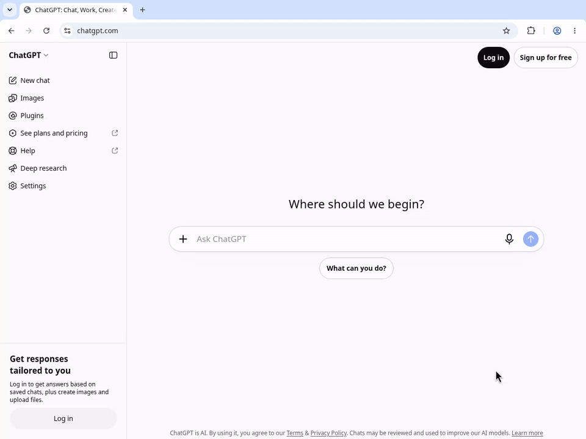

# Ask ChatGPT Now

### Your question. One Enter.

Type a question in Chrome's address bar. Press **Enter**. ChatGPT opens in the **same tab**, and the extension fills in your question and clicks **Send** once.

No second Send click. No popup. No forced Web Search.

[](https://github.com/liush2yuxjtu/ask-chatgpt-now/actions/workflows/check.yml)
[](https://github.com/liush2yuxjtu/ask-chatgpt-now/releases/latest)
[](LICENSE)

**[Download v3.0.0](https://github.com/liush2yuxjtu/ask-chatgpt-now/releases/download/v3.0.0/ask-chatgpt-now-v3.0.0.zip)** · [Keep your default engine](https://github.com/liush2yuxjtu/ask-chatgpt-now/releases/download/v3.0.0/ask-chatgpt-now-keep-default-v3.0.0.zip) · [中文说明](README.zh-CN.md)



*Actual 9-second Chrome recording, using signed-out ChatGPT. [Watch the MP4](https://raw.githubusercontent.com/liush2yuxjtu/ask-chatgpt-now/main/docs/verification/browser-verification.mp4) · [Read the test report](docs/VERIFICATION.md). A real signed-in account has not yet been verified.*

## Make the address bar your prompt box

```text
Explain DNS in one sentence.                   → Enter → ChatGPT
帮我把这句话改得更自然：明天我们讨论一下。       → Enter → ChatGPT
Give me three ideas for a weekend side project. → Enter → ChatGPT
```

Use ordinary questions: no `ask` prefix and no Tab shortcut. Chrome still treats URLs as website navigation. The extension uses the ChatGPT website; it needs no API key and does not select or unlock a model. Your ChatGPT account, available models, and usage limits apply.

## Install the preview

**Available on GitHub as a developer preview. Chrome Web Store publication is pending; these ZIPs require manual loading.** See [distribution status](docs/DISTRIBUTION.md).

1. Download **one** build below and extract the ZIP to a folder you will keep.
2. Open `chrome://extensions` and turn on **Developer mode**.
3. Click **Load unpacked** and select the extracted folder containing `manifest.json`.
4. Refresh any already-open ChatGPT pages. For the main build, accept Chrome's search-provider change if offered; use the manual setup below if needed.
5. Enter a question in the address bar and press **Enter**. If ChatGPT requires login, sign in and retry from the address bar.

| Build | What changes | Download |
| --- | --- | --- |
| **Main** | Requests ChatGPT as Chrome's default search provider. | [ZIP](https://github.com/liush2yuxjtu/ask-chatgpt-now/releases/download/v3.0.0/ask-chatgpt-now-v3.0.0.zip) |
| **Keep default** | Keeps Google.com or Bing.com as the default setting and redirects their search navigations to ChatGPT. | [ZIP](https://github.com/liush2yuxjtu/ask-chatgpt-now/releases/download/v3.0.0/ask-chatgpt-now-keep-default-v3.0.0.zip) |

The keep-default build supports HTTPS searches on `google.com`, `www.google.com`, `bing.com`, and `www.bing.com`. It also redirects searches started on those websites, but only address-bar searches are authorized to auto-send. Other engines and country domains are unsupported. Its extra site and redirect permissions are opt-in through this separate build.

Enable only one build. When upgrading from v1/v2, remove the old extension or replace its folder and click **Reload**. Refresh ChatGPT afterward.

<details>
<summary><strong>Main build: manual search-provider setup, including Linux</strong></summary>

Chrome documents automatic extension search-provider overrides for Windows and macOS. On Linux, or if your existing provider still has an old URL:

1. Open `chrome://settings/searchEngines`.
2. Add or edit a ChatGPT site-search entry with shortcut `chatgpt.com` and this URL:

   ```text
   https://chatgpt.com/?ask_chatgpt_now=1#ask-chatgpt-now=%s
   ```

3. Use that entry's menu to choose **Make default**. This may first require activating the entry under Site search.

The URL is a Chrome search-provider template that requires this extension. Clicking or pasting a prompt URL is not an authorized address-bar search and will not auto-send.

</details>

Need a direct repository download? [Main ZIP](https://raw.githubusercontent.com/liush2yuxjtu/ask-chatgpt-now/main/downloads/ask-chatgpt-now-v3.0.0.zip) · [Keep-default ZIP](https://raw.githubusercontent.com/liush2yuxjtu/ask-chatgpt-now/main/downloads/ask-chatgpt-now-keep-default-v3.0.0.zip) · [SHA-256 checksums](downloads/SHA256SUMS.txt).

## What has passed

The public v3 download was tested in a real, visible Chrome window with the actual ChatGPT website:

| Check | Observed result |
| --- | --- |
| Native address-bar question + Enter | One Enter; no keyword or Tab shortcut |
| Send action | Extension: **1** click · manual: **0** clicks |
| Real ChatGPT conversation | **HTTP 200** and the expected answer |
| Browser destination | Original tab; no added tab or window |
| Keep-default build with Google | Default-provider settings unchanged |
| Syntax, unit tests, packaging | Passed; **9** unit tests |

**Scope:** live website tests used signed-out ChatGPT on Chrome for Testing 151 on Linux. Signed-in accounts and Windows/macOS automatic provider setup remain unverified. Prefilled textarea/contenteditable regressions passed on controlled fixtures; those fixtures are not live account tests. [Evidence and repeatable checks →](docs/VERIFICATION.md)

## One handoff, one Send

The extension checks Chrome's navigation metadata, waits for the composer and Send button, then sends once. It removes the handoff marker before sending. Reloads, Back, and ordinary webpage links do not authorize another send.

An unrelated draft stops auto-send. If the page is not ready, requires login, or changes its interface, the extension shows a status message instead of repeatedly clicking. A plain `chatgpt.com/?q=...` link can merely prefill a draft; v3 performs the Send action itself.

## Privacy

No analytics, telemetry, remote scripts, or publisher-operated chat backend. The extension temporarily holds the handoff in browser memory and interacts with the ChatGPT composer. ChatGPT receives your question when it is sent, under [OpenAI's privacy policy](https://openai.com/policies/privacy-policy/).

The prompt fragment may appear in the address bar or history before it is removed. Existing browser search suggestions can still go to your search provider; the keep-default build also relies on Google/Bing search navigations. [Full privacy and permission details →](PRIVACY.md)

## Pass it on

Know someone who asks ChatGPT questions all day? Send them the repo:

> Ask ChatGPT Now: type a question in Chrome's address bar, press Enter, and let the extension send it to ChatGPT in the same tab. Open source, no API key. Developer preview: https://github.com/liush2yuxjtu/ask-chatgpt-now

**[Star the project](https://github.com/liush2yuxjtu/ask-chatgpt-now)** to find it again. [Report an issue](https://github.com/liush2yuxjtu/ask-chatgpt-now/issues/new) with your Chrome version, build, and whether ChatGPT was signed in. Keep private prompts out of screenshots.

## Build it yourself

Node.js 20+ and Python 3. Ordinary checks and packaging need no npm dependencies.

```sh
npm run check
npm test
npm run package
```

Archives are written to `dist/`, with `manifest.json` at the root. The release workflow checks committed ZIP contents against the corresponding real-browser report before uploading them. Live browser tests are separate from CI; see [verification](docs/VERIFICATION.md).

[MIT licensed](LICENSE). Independent project; not affiliated with or endorsed by OpenAI or Google. ChatGPT is an OpenAI product.
