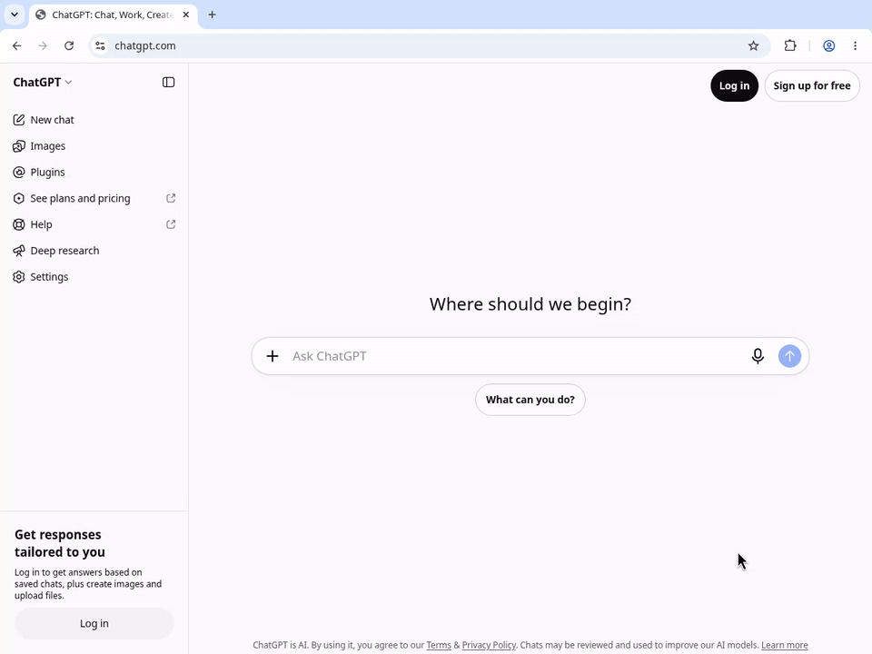

# Ask ChatGPT Now

### 问题写在地址栏，按一次 Enter。

直接在 Chrome 地址栏输入问题，按 **Enter**，在**当前标签页**进入 ChatGPT。扩展自动填入问题，并点击 **Send 一次**。

不用再点发送，不弹新窗口，也不强制开启网页搜索。

**[下载 v3.0.0](https://github.com/liush2yuxjtu/ask-chatgpt-now/releases/download/v3.0.0/ask-chatgpt-now-v3.0.0.zip)** · [保留默认搜索引擎版](https://github.com/liush2yuxjtu/ask-chatgpt-now/releases/download/v3.0.0/ask-chatgpt-now-keep-default-v3.0.0.zip) · [English](README.md)



*真实 Chrome 操作录屏，约 9 秒；使用未登录的 ChatGPT。[原始 MP4](https://raw.githubusercontent.com/liush2yuxjtu/ask-chatgpt-now/main/docs/verification/browser-verification.mp4) · [验证报告](docs/VERIFICATION.md)。尚未完成真实已登录账号验证。*

## 把地址栏变成提问框

```text
用一句话解释什么是 DNS。                  → Enter → ChatGPT
帮我把这句话改得更自然：明天我们讨论一下。   → Enter → ChatGPT
给我三个适合周末做的小项目。               → Enter → ChatGPT
```

不用输入 `ask` 前缀，也不用先按 Tab。网址仍由 Chrome 当作网站地址打开。扩展使用 ChatGPT 网站，不需要 API key，不指定或解锁模型；可用模型和使用限额由 ChatGPT 决定。

## 安装预览版

**目前在 GitHub 发布开发者预览版，尚未上架 Chrome 商店。ZIP 需要手动加载。** [商店发布状态及条件](docs/DISTRIBUTION.md)。

1. 下载下面**一个**版本，解压到你会保留的文件夹。
2. 打开 `chrome://extensions`，开启右上角**开发者模式**。
3. 点击**加载已解压的扩展程序**，选择包含 `manifest.json` 的解压文件夹。
4. 刷新已经打开的 ChatGPT 页面。主版本如提示更改搜索引擎，确认该设置；未生效时按下方说明手动配置。
5. 在地址栏输入问题，按 **Enter**。若 ChatGPT 要求登录，登录后从地址栏重新提问。

| 版本 | 行为 | 下载 |
| --- | --- | --- |
| **主版本** | 请求把 Chrome 默认搜索引擎设为 ChatGPT。 | [ZIP](https://github.com/liush2yuxjtu/ask-chatgpt-now/releases/download/v3.0.0/ask-chatgpt-now-v3.0.0.zip) |
| **保留默认引擎版** | 保持 Google.com / Bing.com 的默认设置，将它们的搜索导航转到 ChatGPT。 | [ZIP](https://github.com/liush2yuxjtu/ask-chatgpt-now/releases/download/v3.0.0/ask-chatgpt-now-keep-default-v3.0.0.zip) |

保留默认版支持 HTTPS 下的 `google.com`、`www.google.com`、`bing.com` 和 `www.bing.com`。这些网站内发起的搜索也会被重定向，但只有地址栏搜索才获准自动发送。不支持其他引擎或国家域名；该独立版本额外请求相应网站权限和重定向权限。

只启用一个版本。从 v1/v2 升级时，移除旧扩展，或替换原文件夹后点击**重新加载**，再刷新 ChatGPT。

<details>
<summary><strong>主版本手动配置，包括 Linux</strong></summary>

Chrome 文档说明，扩展自动覆盖搜索引擎设置适用于 Windows 和 macOS。Linux 或仍使用旧查询网址的用户，请手动配置：

1. 打开 `chrome://settings/searchEngines`。
2. 添加或编辑 ChatGPT 网站搜索条目，快捷字词填 `chatgpt.com`，网址填：

   ```text
   https://chatgpt.com/?ask_chatgpt_now=1#ask-chatgpt-now=%s
   ```

3. 在该条目的菜单中选择**设为默认**。可能需要先在网站搜索列表中激活该条目。

这是需要配合扩展使用的 Chrome 搜索模板。直接点击或粘贴问题链接不会获得地址栏搜索授权，也不会自动发送。

</details>

仓库备用下载：[主版本](https://raw.githubusercontent.com/liush2yuxjtu/ask-chatgpt-now/main/downloads/ask-chatgpt-now-v3.0.0.zip) · [保留默认版](https://raw.githubusercontent.com/liush2yuxjtu/ask-chatgpt-now/main/downloads/ask-chatgpt-now-keep-default-v3.0.0.zip) · [SHA-256 校验值](downloads/SHA256SUMS.txt)。

## 已验证的效果

公开下载的 v3 安装包已在真实、有界面的 Chrome 中测试，使用真正的 ChatGPT 网站：

| 检查项 | 观察结果 |
| --- | --- |
| 原生地址栏输入问题 | Enter 1 次，无前缀，无 Tab |
| 发送按钮 | 扩展点击 **1 次**，人工点击 **0 次** |
| 真实 ChatGPT 对话 | **HTTP 200**，收到预期回答 |
| 标签页与窗口 | 保持当前标签页，无新增标签或窗口 |
| 保留默认版 + Google | 默认搜索引擎设置前后不变 |
| 语法、单元测试、打包 | 通过；共 **9 项**单元测试 |

**验证范围：** 实站使用 Linux 上的 Chrome for Testing 151，ChatGPT 未登录。真实已登录账号、Windows/macOS 自动覆盖搜索引擎仍未验证。预填但未发送的 textarea/contenteditable 回归使用受控页面，不代表已登录账号通过。[完整证据与复现方法 →](docs/VERIFICATION.md)

## 每次交接，只发一次

扩展检查 Chrome 提供的地址栏导航信息，等待输入框和 Send 按钮就绪，移除交接标记后发送一次。刷新、后退、普通网页链接不会授权再次发送。

发现不相关草稿时停止，避免覆盖；页面未就绪、要求登录或界面变化时会显示状态提示，不循环点击。单独的 `chatgpt.com/?q=...` 链接可能只预填草稿；v3 由扩展执行发送。

## 隐私

没有分析统计、遥测、远程脚本或发布者运营的聊天后端。扩展在浏览器内存中暂存交接信息，只操作 ChatGPT 输入框和发送按钮。问题发送后，由 ChatGPT 按 [OpenAI 隐私政策](https://openai.com/policies/privacy-policy/)处理。

问题片段在移除前可能出现在地址栏或历史记录中。浏览器原有搜索建议仍可能发给搜索引擎；保留默认版还依赖 Google/Bing 的搜索导航。[隐私与权限详情 →](PRIVACY.md)

## 分享给每天都在问 ChatGPT 的人

可以直接复制这段：

> 我把 Chrome 地址栏变成了 ChatGPT 提问框：输入问题，按 Enter，同一标签页自动发送。开源，不需要 API key。目前是开发者预览版：https://github.com/liush2yuxjtu/ask-chatgpt-now

**[Star 收藏项目](https://github.com/liush2yuxjtu/ask-chatgpt-now)**。遇到问题可[提交 Issue](https://github.com/liush2yuxjtu/ask-chatgpt-now/issues/new)，附上 Chrome 版本、所用安装包、ChatGPT 是否登录；截图请避开私人内容。

## 自己构建

需要 Node.js 20+ 和 Python 3；普通检查与打包无需安装 npm 依赖。

```sh
npm run check
npm test
npm run package
```

输出位于 `dist/`，ZIP 根目录包含 `manifest.json`。发布工作流会把已提交的 ZIP 与对应实站报告逐文件校验，再上传附件。CI 不发送 ChatGPT 问题；实站测试见[验证说明](docs/VERIFICATION.md)。

[MIT 许可](LICENSE)。独立项目，与 OpenAI、Google 无隶属关系，亦未经其背书。ChatGPT 是 OpenAI 的产品。
